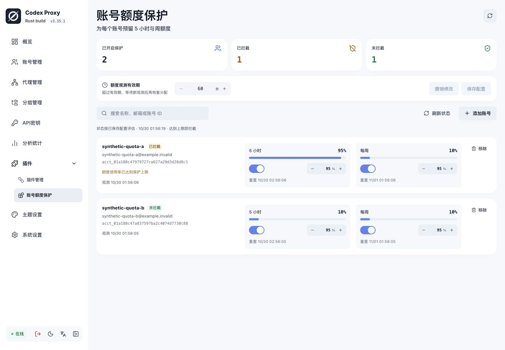
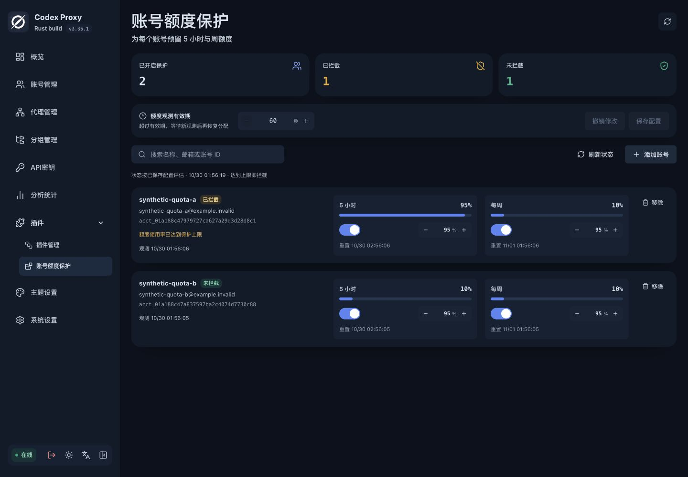

# 账号额度保护 · CPR Quota Guard

为 [Codex Proxy RS](https://github.com/zyycn/codex-proxy-rs) 的 OpenAI OAuth 账号预留额度
每个账号可以分别设置 5 小时和周额度使用率上限；任一窗口达到上限时，停止为它分配新请求，已发出的请求继续完成

插件通过公开 SDK 读取额度、收窄候选账号和刷新观测，宿主继续负责权重、Smart 调度、会话亲和与租约
使用率以宿主观测为准，无法保证并发请求或其他客户端的使用量严格停在指定百分比

## 安装与配置

需要 Codex Proxy RS **3.35.1 或以上的 3.x 版本**，并支持 RPC v7、management v2、页面桥 v2、scheduler v3、command_line v1、maintenance v1
SDK 固定到 [`12771aca`](https://github.com/zyycn/codex-proxy-rs/tree/12771aca8719ed4b23b0362b23d8d81f228190ca)，宿主升级后应重新验证兼容性
Linux 包适用于 **x86_64、glibc 2.28+**，不适用于 Alpine/musl

1. 在宿主“插件管理”点击安装，选择 **GitHub** 来源，仓库填写 `Mr-xiongyq/cpr-quota-guard`，标签填写 `v0.2.3`，选择与宿主运行平台匹配的附件并核对 SHA-256
2. 打开插件的“账号额度保护”扩展页，点击“添加账号”，选择 **OpenAI OAuth 账号**，设置两个窗口的上限并保存配置；默认没有受保护账号
3. 在高级设置将调度阶段的 Provider 范围设为 **OpenAI**，保持失败处理为 **拒绝请求**，并确保功能范围覆盖需要保护的请求
4. 启用后等待后台取得有效额度观测，再通过正常网关请求使用

插件 ID 为 `mr-xiongyq.quota-guard`，作者为 `Mr-xiongyq`
安装流程见[官方插件使用文档](https://github.com/zyycn/codex-proxy-rs/blob/12771aca8719ed4b23b0362b23d8d81f228190ca/docs/plugins.md)

也可从 [v0.2.3 Release](https://github.com/Mr-xiongyq/cpr-quota-guard/releases/tag/v0.2.3) 下载安装包和同名 `.sha256` 文件，通过“上传包”安装

| 宿主运行平台 | 安装包 |
| --- | --- |
| Linux x86_64，glibc 2.28+ | `mr-xiongyq.quota-guard-0.2.3-x86_64-unknown-linux-gnu.tar.gz` |
| macOS arm64 | `mr-xiongyq.quota-guard-0.2.3-aarch64-apple-darwin.tar.gz` |

平台按运行 codex-proxy-rs 的服务器或容器选择，与访问管理页面的电脑无关
GitHub 自动生成的 Source code 压缩包是源码，不能作为插件安装包

宿主不允许多个账号调度插件的功能范围重叠，也不能通过调整顺序把它们串成过滤链
已有调度插件时，应先规划互不重叠的 Key、分组或 Provider 范围；本插件的空账号列表仍保留调度绑定

页面可以查看额度进度、观测时间与暂停原因，分别开关两个窗口并调整观测有效期
“刷新状态”只读取宿主现有观测，额度更新由后台维护完成；在同一配置版本内，刷新状态不会覆盖未保存草稿
保存带配置版本校验，配置发生竞争修改时需通过宿主刷新页面后重新确认
保存成功后规则立即生效，点击宿主右上角“刷新页面”查看新配置和状态
页面与宿主 JSON 编辑器使用同一份配置，配置示例也见 [examples/config.json](examples/config.json)：

```json
{
  "accounts": [
    { "accountId": "your-openai-account-id", "fiveHourLimitPercent": 95, "weeklyLimitPercent": 99 },
    { "accountId": "another-openai-account-id", "fiveHourLimitPercent": null, "weeklyLimitPercent": 90 }
  ],
  "maxObservationAgeSeconds": 300
}
```

| 参数 | 含义 |
| --- | --- |
| `accounts` | 明确指定的账号，最多 1000 个；ID 不可重复，不是邮箱、名称或 Key |
| `fiveHourLimitPercent` | 5 小时使用率上限，省略为 95；范围 0–100，`null` 关闭该窗口 |
| `weeklyLimitPercent` | 周使用率上限，省略为 95；范围 0–100，`null` 关闭该窗口 |
| `maxObservationAgeSeconds` | 观测有效期，默认 300 秒；范围 60–86400 秒 |

上限比较包含等号，例如 95% 会阻止已观测为 95% 的账号；0 表示始终触发，不表示关闭
两个窗口都设为 `null` 时，该账号的保护和主动刷新都关闭；未配置的账号以及 xAI 调度请求保持委托宿主
仅识别 `limit_id=codex` 通用额度桶中的 18000 秒与 604800 秒窗口，其他模型或功能额度桶不会被当作账号总额度
不支持用 URL + API Key 接入、没有这些额度窗口的账号

## 界面

页面使用宿主组件与主题，支持账号选择、阈值编辑、保护状态和额度进度展示
以下是 Codex Proxy RS 3.35.1 中的实际页面，账号与额度使用合成测试数据



<details>
<summary>查看深色主题</summary>



</details>

## 保护与恢复

启用的额度窗口必须都有可靠使用率、有效重置时间及未过期观测，且全部低于上限，插件才允许账号参与调度
缺失窗口、未知使用率、观测过旧、观测时间在未来、窗口已过重置点或读取失败时，会暂时排除该账号
达到重置时间不等于额度已经恢复，只有宿主提供有效的新观测才会恢复分配

后台维护由宿主在启用、恢复、配置变更时触发，通常每轮结束 30 秒后再次执行
观测接近有效期一半，或存在需要更新的不可靠事实时，插件请求宿主刷新额度；每账号主动刷新间隔至少 60 秒，每轮最多 32 次，按账号轮转
刷新使用宿主现有凭据、代理与 Provider 逻辑，不消耗重置券，不修改 Client Key 预算
刷新失败或返回旧观测不会解除保护；模型请求与 `status` 命令只读已有观测，不访问上游刷新

大量账号、上游缓慢或额度刷新失败时，完整维护轮转可能超过观测有效期，相关账号会继续被排除
可按账号规模调整有效期；较长有效期也意味着接受更旧的数据，较短有效期可能增加暂时无可用账号的次数
插件不持久化第二份额度或账号启用状态，重启后继续根据宿主事实评估；刷新节流计时在进程重启后重新开始

全部候选被排除，或严格跟随会话绑定的账号被排除时，模型 HTTP API 返回 403，错误码为 `policy_denied`；内部诊断原因为 `account_policy_filtered`，不会回退到这些账号
如果把调度失败策略改成委托，插件进程故障或超时可能绕过保护；插件停用、未挂载或因宿主不兼容未启动时也不提供保护

## 查看暂停原因

在宿主环境运行：

```sh
codex-proxy-rs plugin <配置ID> status
codex-proxy-rs plugin <配置ID> status --account-id <账号ID>
```

返回 JSON，包含每个账号的 `excluded`、中文 `reasons` 及可用的使用率、上限和 `resetAtMs`（UTC Unix 毫秒）
`excluded: false` 仅表示本插件没有排除该账号，不保证宿主权限、健康、租约等其他条件满足
`resetAtMs` 是上游观测的窗口重置时间，不是保证恢复服务的时间
诊断与实际调度共用同一评估逻辑，状态查询也不会泄露凭据或宿主原始错误

## 开发与打包

Rust 工具链由 `rust-toolchain.toml` 固定，Cargo.lock 固定依赖
源码独立于宿主 workspace，只依赖公开 `gateway-plugin-sdk`，不需要数据库、Redis 或真实账号来运行自动测试

页面使用 Vue 3、TypeScript 和宿主的 `@codex-proxy/ui` 组件，通过插件页面桥访问已注册路由
Node.js 26 与 pnpm 12.6.0 用于前端构建，依赖由 `frontend/pnpm-lock.yaml` 固定

```sh
cargo fmt --all -- --check
cargo clippy --all-targets --all-features --locked -- -D warnings
cargo test --locked
pnpm --dir frontend install --frozen-lockfile
pnpm --dir frontend lint
pnpm --dir frontend build
```

测试包括纯策略边界和实际插件子进程的 RPC；测试宿主使用合成额度，不访问真实上游
发布版本的验证结果见 [发布说明](release/notes.md)

从同一固定提交构建官方打包工具：

```sh
cargo install --locked --git https://github.com/zyycn/codex-proxy-rs \
  --rev 12771aca8719ed4b23b0362b23d8d81f228190ca codex-proxy-plugin-cli
```

Linux x86_64 原生构建：

```sh
cargo build --release --locked --target x86_64-unknown-linux-gnu
cpr-plugin package --manifest plugin.json \
  --binary target/x86_64-unknown-linux-gnu/release/cpr-quota-guard \
  --resource-map web=frontend/dist \
  --target x86_64-unknown-linux-gnu --output-dir dist
```

原生链接的 glibc 最低版本取决于构建环境
在 macOS 等环境交叉构建 glibc 2.28 目标时，先安装目标 Rust 标准库、Zig 与 [cargo-zigbuild](https://github.com/rust-cross/cargo-zigbuild)，再用以下命令替换 `cargo build`：

```sh
rustup target add x86_64-unknown-linux-gnu
cargo zigbuild --release --locked --target x86_64-unknown-linux-gnu.2.28
```

设置了 `CARGO_TARGET_DIR` 时，打包的 `--binary` 路径也要指向对应目录
产物为 `mr-xiongyq.quota-guard-0.2.3-x86_64-unknown-linux-gnu.tar.gz` 及 `.tar.gz.sha256`，源码压缩包不能替代安装包
页面源码变更后需重新构建、打包并切换插件版本，宿主读取安装包内的资源

## 相关讨论

- 额度保护需求：[codex-proxy-rs #463](https://github.com/zyycn/codex-proxy-rs/issues/463)，分别设置 5 小时与周额度使用率上限，并在新观测满足条件后恢复调度
- 调度接口背景：[codex-proxy-rs #444](https://github.com/zyycn/codex-proxy-rs/issues/444)，排除部分候选后继续委托宿主原生调度

本插件通过现有 SDK 实现策略与独立管理页面，剩余账号的选择继续由宿主完成

## 许可

Apache-2.0，见 [LICENSE](LICENSE)
